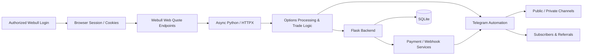

# Camel SPX — Webull Options Data & Telegram Automation Backend

Backend and automation portfolio project for a real-time options workflow that connects an authenticated Webull web session with Python data-processing services, Telegram bots, subscriptions, and operational dashboards.

> **Portfolio scope:** my contribution to this project focused on the **backend**, **Webull data integration**, **login/session workflow**, and the **Telegram layer in full**. Frontend templates are included only where they help demonstrate backend integration and are not presented as my primary contribution.

## My Contribution

I was responsible for:

- Building the Webull data acquisition workflow for options and market data.
- Implementing the login/session process used to obtain an authenticated Webull browser session.
- Capturing and identifying the Webull web endpoints required for option-chain data.
- Reusing authenticated cookies/session values in asynchronous HTTP requests.
- Fetching and processing option chains for indices and equities.
- Building the Telegram automation layer end-to-end.
- Publishing trading alerts and generated trade summaries to public/private Telegram destinations.
- Managing Telegram users, subscriptions, referral flows, notifications, and channel access.
- Connecting Telegram workflows with the Flask backend and SQLite persistence.
- Integrating payment/webhook flows used by subscription bots.
- Building scheduled monitoring/reporting workflows around the trading data.

## Webull Integration

The project uses an authenticated **Webull web-session integration** rather than embedding credentials in source code.

### 1. Login and session capture

`login.py` opens Webull in a real browser session using Selenium. After an authorized manual login, the local session cookies can be saved for development use.

`cookies.json` is intentionally excluded from this public repository.

### 2. Network endpoint discovery

`gethttpx.py` uses Playwright to observe Webull network traffic and capture the requests relevant to the options workflow, including:

```text
/api/quote/option/strategy/list
/api/quote/option/quotes/queryBatch
```

Raw network captures are intentionally excluded from the public portfolio version.

### 3. Async market-data requests

The main trading services use `httpx.AsyncClient` to request option-chain data from Webull's quote gateway while reusing the authorized session context.

Sensitive session values such as access tokens, device identifiers, request signatures, and cookies are loaded from environment/local runtime configuration and are never committed.

## Telegram Automation

The Telegram implementation includes:

- Bot commands and interactive keyboards
- Public/private channel workflows
- Trade alerts and generated summary images
- User registration
- Phone/contact collection
- Subscription packages
- Referral codes and rewards
- Subscription expiry handling
- Private-channel access management
- Admin notifications
- Indicator subscription workflows
- Payment-link and webhook integration
- Telegram-to-Flask API integration
- Scheduled reporting and monitoring tasks

## High-Level Architecture



## Main Modules

| Module | Purpose |
|---|---|
| `login.py` | Authorized Webull browser login and local cookie capture |
| `gethttpx.py` | Network inspection for Webull option endpoints |
| `spx1.py` | Main SPX/index options and Telegram automation workflow |
| `camel_company.py` | Equity-option workflow and Telegram automation |
| `payment_bot.py` | Telegram subscriptions, referrals, access and user lifecycle |
| `payment_bot1.py` | Indicator subscription/payment bot |
| `app.py` | Flask dashboard/API, settings, users, payments and operational workflows |
| `app_integration.py` | Telegram WebApp/backend integration |
| `update_db.py` | Local database maintenance/migration helper |

## Markets / Instruments

The code contains workflows for index and equity options, including SPX/SPY/QQQ/NDX and selected U.S. equities.

## Tech Stack

- **Python**
- **Flask**
- **Telegram Bot API / python-telegram-bot**
- **Webull web-session integration**
- **HTTPX / async I/O**
- **Playwright**
- **Selenium**
- **SQLite**
- **Pandas / NumPy**
- **APScheduler**
- **Pillow**
- **REST APIs & Webhooks**

## Local Configuration

Install dependencies:

```bash
python -m venv .venv
pip install -r requirements.txt
playwright install chromium
```

Create local configuration:

```bash
cp .env.example .env
```

Populate only your own authorized development credentials/session values.

## Security

This repository is a **sanitized portfolio snapshot**. The following were removed before publication:

- Telegram bot tokens
- Payment/API secrets
- Webhook secrets
- Webull cookies and session tokens
- Webull raw network captures
- SQLite user databases
- User phone numbers and customer records
- Trade-history data generated in production
- Private Git history
- Cached Python bytecode
- Environment-specific media/assets

See `SECURITY.md`.

## Repository Note

Some production-oriented modules originated in a live operational environment and therefore contain environment-specific logic. This public version is intended to demonstrate backend architecture, API integration, automation, and engineering responsibilities without publishing operational credentials or customer data.

## Author / Contribution

**Hassan Ali Hassan**  
Backend, API Integration, Webull Data Engineering & Telegram Automation
